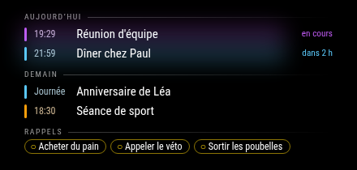

# MMM-HAAgenda

Module [MagicMirror²](https://magicmirror.builders) qui affiche les événements d'aujourd'hui et de demain de tous vos calendriers [Home Assistant](https://www.home-assistant.io), et une liste de rappels. Calendriers iCloud, Google, CalDAV, locaux… : tout ce que Home Assistant connaît arrive sur le miroir.



- **Une ligne par événement**, avec la couleur de son calendrier sur la barre de gauche.
- **Compte à rebours** : « dans 25 min », « dans 2 h 05 », puis « en cours ».
- **Aujourd'hui en avant** : un léger halo de la couleur du calendrier derrière les événements du jour.
- **Rappels en pastilles**, depuis n'importe quelle liste de tâches Home Assistant.
- **Rien à configurer côté miroir** : pas de jeton ni de mot de passe. C'est Home Assistant qui envoie l'agenda au miroir.
- Le module reste invisible quand il n'y a rien à afficher. Textes en français.

## Comment ça marche

Home Assistant lit vos calendriers, puis envoie toutes les 10 minutes les événements et les rappels au miroir, à l'adresse `http://<miroir>:8080/MMM-HAAgenda`. Le module les affiche. Le miroir n'a donc besoin d'aucun accès à Home Assistant.

## Installation

```sh
cd ~/MagicMirror/modules
git clone https://github.com/FabienBounoir/MMM-HAAgenda.git
```

Pas de `npm install` nécessaire (Node 18 ou plus).

```js
{
	module: "MMM-HAAgenda",
	position: "top_right"
}
```

Si Home Assistant ne tourne pas sur la même machine que le miroir, vérifiez que MagicMirror écoute sur le réseau (`address: "0.0.0.0"` et l'adresse de Home Assistant dans `ipWhitelist` de `config.js`).

## Côté Home Assistant

### 1. Vos calendriers

Ajoutez vos calendriers dans Home Assistant (Paramètres → Appareils et services). Pour iCloud : intégration **CalDAV**, adresse `https://caldav.icloud.com/`, votre identifiant Apple et un [mot de passe pour app](https://support.apple.com/fr-fr/102654). Tous les calendriers de Home Assistant sont envoyés au miroir, il n'y a rien à lister.

### 2. L'envoi vers le miroir

Dans `configuration.yaml`, remplacez `<IP_DU_MIROIR>` :

```yaml
rest_command:
  magicmirror_agenda:
    url: "http://<IP_DU_MIROIR>:8080/MMM-HAAgenda"
    method: POST
    content_type: "application/json"
    payload: "{{ agenda | tojson }}"
```

Dans `automations.yaml` (ou en YAML dans l'éditeur d'automatisations). Remplacez `todo.rappels` par votre liste de tâches, ou supprimez les deux étapes qui la concernent :

```yaml
- id: agenda_miroir
  alias: Agenda et rappels → miroir
  triggers:
    - trigger: time_pattern
      minutes: /10
    - trigger: homeassistant
      event: start
    - trigger: state
      entity_id: todo.rappels
  actions:
    - delay:
        seconds: 3
    - variables:
        events: {}
    - if:
        - condition: template
          value_template: "{{ states.calendar | count > 0 }}"
      then:
        - action: calendar.get_events
          target:
            entity_id: "{{ states.calendar | map(attribute='entity_id') | list }}"
          data:
            start_date_time: "{{ now() }}"
            end_date_time: "{{ today_at() + timedelta(days=2) }}"
          response_variable: events
          continue_on_error: true
    - action: todo.get_items
      target:
        entity_id: todo.rappels
      data:
        status: needs_action
      response_variable: todos
      continue_on_error: true
    - action: rest_command.magicmirror_agenda
      data:
        agenda:
          events: "{{ events }}"
          reminders: "{{ todos['todo.rappels']['items'] if todos is defined else [] }}"
  mode: restart
```

Redémarrez Home Assistant (ou rechargez les commandes REST et les automatisations). L'agenda apparaît sur le miroir dans les 10 minutes.

### 3. Rappels Apple (facultatif)

Apple ne rend pas l'app Rappels accessible à Home Assistant. Pour les afficher quand même, un Raccourci iPhone peut envoyer la liste à Home Assistant.

1. Dans Home Assistant, créez une liste de tâches « Rappels iPhone » (intégration **Liste de tâches locale**).
2. Ajoutez cette automatisation, avec un identifiant de webhook à vous, long et difficile à deviner :

```yaml
- id: rappels_iphone_sync
  alias: Rappels iPhone → Home Assistant
  triggers:
    - trigger: webhook
      webhook_id: <UN_IDENTIFIANT_SECRET>
      allowed_methods: [POST]
      local_only: true
  actions:
    - action: todo.get_items
      target:
        entity_id: todo.rappels_iphone
      response_variable: current
    - variables:
        old: "{{ current['todo.rappels_iphone']['items'] | map(attribute='uid') | list }}"
        new: "{{ (((trigger.json or {}).get('rappels') or '') ~ '').split('\n') | map('trim') | reject('eq', '') | unique | list }}"
    - if:
        - condition: template
          value_template: "{{ old | count > 0 }}"
      then:
        - action: todo.remove_item
          target:
            entity_id: todo.rappels_iphone
          data:
            item: "{{ old }}"
    - repeat:
        for_each: "{{ new[:50] }}"
        sequence:
          - action: todo.add_item
            target:
              entity_id: todo.rappels_iphone
            data:
              item: "{{ repeat.item }}"
  mode: queued
```

3. Sur l'iPhone, créez un Raccourci :
   - **Rechercher des rappels**, avec le filtre « Est terminé : non » ;
   - **Combiner le texte**, séparateur « Nouvelle ligne » ;
   - **Obtenir le contenu de l'URL** : `http://<IP_DE_HOME_ASSISTANT>:8123/api/webhook/<UN_IDENTIFIANT_SECRET>`, méthode POST, corps JSON avec un champ texte `rappels` qui contient le texte combiné.
4. Dans l'onglet Automatisation, déclenchez-le quand l'app Rappels **est fermée**, avec « Exécuter immédiatement ».

Avec `local_only: true`, l'envoi ne fonctionne que depuis le Wi-Fi de la maison.

## Options

| Option | Défaut | Description |
| --- | --- | --- |
| `maxEvents` | `6` | Nombre maximum d'événements affichés |
| `maxReminders` | `6` | Nombre maximum de rappels affichés |
| `colors` | `{}` | Couleur par calendrier, par exemple `{ "calendar.travail": "#ff9f0a" }`. Sinon, une couleur est attribuée à chaque calendrier dans l'ordre alphabétique |
| `reminderColor` | `"#ffd60a"` | Couleur des pastilles de rappels |

## Format reçu

Pour alimenter le module depuis autre chose que Home Assistant, envoyez en POST à `/MMM-HAAgenda` :

```json
{
  "events": {
    "calendar.perso": {
      "events": [
        { "start": "2026-11-16T20:45:00+01:00", "end": "2026-11-16T22:00:00+01:00", "summary": "Dîner" },
        { "start": "2026-11-17", "end": "2026-11-18", "summary": "Anniversaire de Léa" }
      ]
    }
  },
  "reminders": [{ "summary": "Acheter du pain" }]
}
```

C'est le format de réponse de `calendar.get_events` et de `todo.get_items`. Une date sans heure correspond à un événement sur toute la journée.

L'adresse de réception n'a pas de mot de passe : n'importe quel appareil de votre réseau local peut y envoyer un agenda. Le module n'affiche que du texte, ce qui limite le risque, mais n'ouvrez pas le port 8080 du miroir sur Internet.

## Aller avec

Le design reprend celui de [MMM-NowPlayingOnSpotify](https://github.com/FabienBounoir/MMM-NowPlayingOnSpotify) et de [MMM-Meteo](https://github.com/FabienBounoir/MMM-Meteo).

## Test

```sh
node test.js
```

## Licence

MIT
